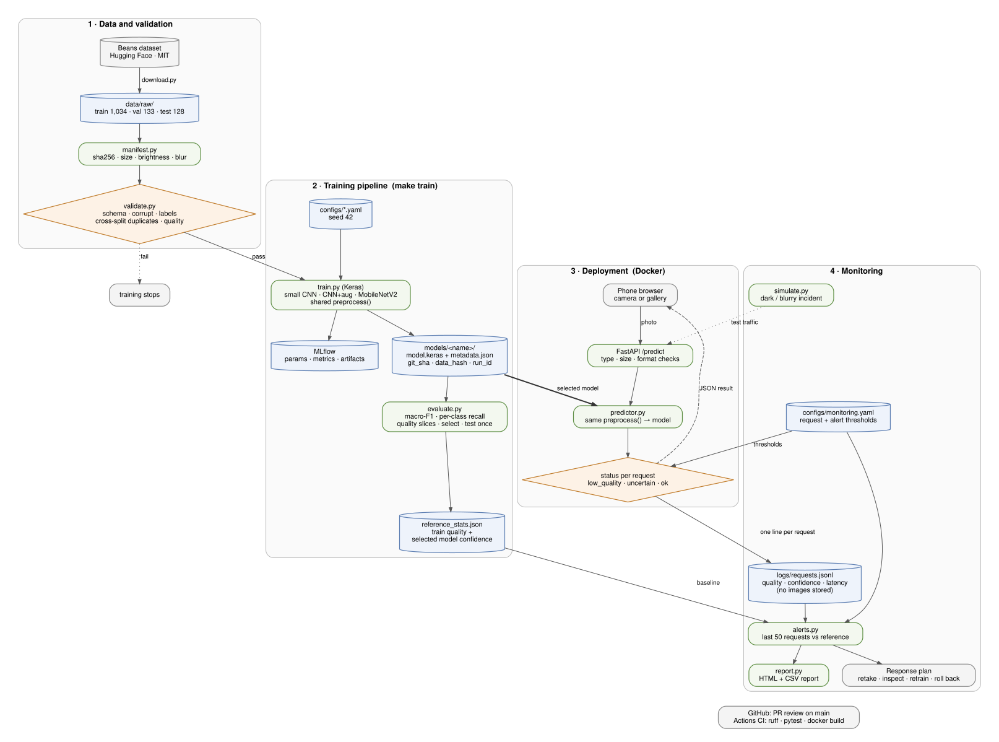

# PlantHealth AI

**DTI6302 — Machine Learning Operations**

PlantHealth AI is an end-to-end machine learning system
for classifying bean leaf images and demonstrating the
operational lifecycle of a machine learning application.

The project integrates dataset validation, reproducible
training, experiment tracking, model selection, inference
serving, containerization, automated testing and
operational monitoring.

## 1. Project overview

The application classifies bean leaf images into three
categories:

- Angular leaf spot
- Bean rust
- Healthy

Users can submit images through a responsive web interface
and receive a predicted class, confidence score, class
probabilities and image-quality feedback.

The system is an educational prototype and is not intended
to replace professional agricultural diagnosis.

## 2. System architecture



The architecture comprises four interconnected layers:

1. **Data and validation:** dataset acquisition, manifest
   generation, quality assessment and leakage checks.
2. **Training and evaluation:** configurable experiments,
   shared preprocessing, MLflow tracking, model registration
   and validation-based model selection.
3. **Deployment:** FastAPI inference, responsive web
   interface and Docker containerization.
4. **Monitoring:** request telemetry, quality checks,
   distribution-shift alerts, operational reports and
   controlled incident simulation.

## 3. Dataset

The project uses the Beans dataset published by Makerere
AI Lab on Hugging Face.

- Source: https://huggingface.co/datasets/AI-Lab-Makerere/beans
- License: MIT
- Original format: 500 x 500 RGB JPEG images
- Model input size: 160 x 160 RGB

| Split | Images |
|---|---:|
| Training | 1,034 |
| Validation | 133 |
| Test | 128 |
| Total | 1,295 |

The dataset validation process checks image integrity,
class labels, schema consistency, image quality and
cross-split duplication.

See [DATA.md](DATA.md) for additional dataset information.

## 4. Installation

### Requirements

- Python 3.10–3.12; Python 3.11 recommended
- Git
- Docker, for containerized deployment
- Internet access for initial dependency installation,
  dataset acquisition and pretrained weights

The project was locally validated using Python 3.11.18
on macOS with Apple Silicon.

Clone the repository and enter the project directory:

```bash
git clone https://github.com/ignancyamichelleg/plant-health-ai.git
cd plant-health-ai
```

Until the final team integration into the default branch
is completed, switch to the integrated project branch:

```bash
git switch p2/mobilenet-and-serving
```

Create and activate a Python virtual environment:

```bash
python3.11 -m venv .venv
source .venv/bin/activate
python -m pip install --upgrade pip
python -m pip install -e ".[dev]"
```

Download and validate the dataset:

```bash
python -m plant_health.data.download
python -m plant_health.data.validate
```

The dataset is stored locally under:

```text
data/raw/
├── train/
├── validation/
└── test/
```

## 5. Training and experiment tracking

Three candidate architectures are implemented:

| Experiment | Architecture | Augmentation |
|---|---|---|
| baseline_cnn | Custom CNN | No |
| cnn_aug | Custom CNN | Yes |
| mobilenet_frozen | Frozen ImageNet MobileNetV2 backbone | Yes |

The experiments use shared preprocessing and configurable
training parameters.

The base configuration specifies a random seed of 42,
an image size of 160, a batch size of 32, a maximum of
60 epochs and an early stopping patience of 10.

Experiment-specific YAML files can override these settings.
The repository's MobileNetV2 configuration specifies a
learning rate of 0.0001, 20 maximum epochs and an early
stopping patience of 5.

### Run training experiments

```bash
python pipelines/train_pipeline.py \
  --config configs/experiments/baseline_cnn.yaml

python pipelines/train_pipeline.py \
  --config configs/experiments/cnn_aug.yaml

python pipelines/train_pipeline.py \
  --config configs/experiments/mobilenet_frozen.yaml
```

Training generates model artifacts, metadata, pipeline
reports and monitoring reference statistics.

MLflow records experiment parameters, metrics and artifacts.

Launch the local MLflow interface:

```bash
mlflow ui --backend-store-uri sqlite:///mlflow.db
```

Open http://127.0.0.1:5000.

Training commands regenerate local experiment artifacts
and may update existing reports. Preserve official results
before repeating experiments.

## 6. Model evaluation and selection

The candidate models are evaluated using validation
accuracy, macro-F1, per-class recall, confusion matrices
and image-quality slices.

Official validation results:

| Model | Accuracy | Macro-F1 | Minimum class recall |
|---|---:|---:|---:|
| baseline_cnn | 84.96% | 84.89% | 77.78% |
| cnn_aug | 82.71% | 82.41% | 65.91% |
| mobilenet_frozen | 81.20% | 80.85% | 63.64% |

**Selected model: baseline_cnn.**

Model selection prioritizes validation macro-F1, with
minimum per-class recall as the tie-breaking criterion.

The test split is excluded from model selection.

See [the official model selection report](reports/model_selection.md)
for the comparative evaluation.

To reproduce validation evaluation:

```bash
python -m plant_health.models.evaluate \
  --model models/baseline_cnn --split validation

python -m plant_health.models.evaluate \
  --model models/cnn_aug --split validation

python -m plant_health.models.evaluate \
  --model models/mobilenet_frozen --split validation

python -m plant_health.models.evaluate --select
```

The final held-out test evaluation is protected by an
explicit final-evaluation flag and a local evaluation
record. It should be performed only once on the selected
model as a coordinated team activity.

The validation results above must not be interpreted as
held-out test performance.

## 7. Model artifacts and provenance

Each trained model is stored with its serving metadata:

```text
models/
├── baseline_cnn/
│   ├── model.keras
│   └── metadata.json
├── cnn_aug/
│   ├── model.keras
│   └── metadata.json
└── mobilenet_frozen/
    ├── model.keras
    └── metadata.json
```

Model metadata includes the model version, class order,
input size, input specification and experiment provenance,
including the MLflow run ID, Git commit and data hash.

Trained weights are distributed separately through the
team's shared model artifacts or regenerated through
the training pipeline. They are not committed to Git.

For the official deployment, use the distributed
baseline_cnn model and its corresponding metadata.

## 8. Native application deployment

From the repository root, with the virtual environment
activated:

```bash
PLANT_HEALTH_MODEL_DIR=models/baseline_cnn \
python -m uvicorn plant_health.serving.api:app \
  --host 127.0.0.1 --port 8000
```

Open the application:

- Web interface: http://127.0.0.1:8000
- Interactive API documentation: http://127.0.0.1:8000/docs
- Health endpoint: http://127.0.0.1:8000/health

The responsive web interface supports image submission,
image preview, prediction results, class probabilities
and quality or uncertainty feedback.

### API endpoints

| Method | Endpoint | Purpose |
|---|---|---|
| GET | / | Web interface |
| GET | /health | Application and model status |
| POST | /predict | Image classification |
| GET | /docs | Interactive API documentation |

The prediction endpoint accepts multipart image uploads
using the field name `file`.

Supported image formats include JPEG, PNG and WebP.
The maximum upload size is 8 MiB.

Example prediction request:

```bash
curl -X POST http://127.0.0.1:8000/predict \
  -F "file=@/path/to/leaf.jpg"
```

The response contains:

- Request ID
- Prediction status
- Predicted class
- Confidence score
- Class probabilities
- Image-quality metrics
- Model version
- Inference latency

Prediction statuses are:

| Status | Meaning |
|---|---|
| ok | Quality and confidence thresholds satisfied |
| uncertain | Model confidence below the configured threshold |
| low_quality | Image fails one or more quality thresholds |

An `ok` status does not guarantee a correct classification.

## 9. Docker deployment

The serving application is packaged using a Python 3.11
slim base image and runs as a non-root user.

Build the image from the repository root:

```bash
docker build -t plant-health-ai:final .
```

Ensure the selected model artifacts are available locally.

Create a persistent request-log directory:

```bash
mkdir -p logs/docker-final
```

Start the container:

```bash
docker run -d \
  --name plant-health-final \
  -p 127.0.0.1:8001:8000 \
  -e PLANT_HEALTH_MODEL_DIR=/app/models/best \
  -v "$(pwd)/models/baseline_cnn:/app/models/best:ro" \
  -v "$(pwd)/logs/docker-final:/app/logs" \
  plant-health-ai:final
```

The model directory is mounted read-only. Request logs
are persisted outside the container.

The Docker application is available at:

http://127.0.0.1:8001

Verify deployment:

```bash
curl http://127.0.0.1:8001/health

docker logs plant-health-final
```

Stop and remove the container when finished:

```bash
docker stop plant-health-final
docker rm plant-health-final
```

The application has been validated in native Python and
Docker environments. For three paired validation images,
both environments returned identical predicted classes,
statuses and probability distributions.

This establishes consistency for the tested inputs, not
general classification accuracy or exhaustive platform
equivalence.

## 10. Monitoring and reliability

The monitoring system operates at two levels.

### Individual request monitoring

Each prediction is assessed using:

| Metric | Threshold |
|---|---:|
| Minimum confidence | 0.60 |
| Minimum brightness | 30 |
| Maximum brightness | 230 |
| Minimum blur metric | 50 |

Image quality takes precedence over confidence when
determining the prediction status.

Prediction telemetry is stored in JSON Lines format.
The request logs contain operational metadata rather
than uploaded image files.

### Aggregate monitoring

The monitoring system evaluates windows of 50 requests,
with a minimum of 20 requests required for alerting.

| Alert | Threshold |
|---|---:|
| Low-quality request rate | Above 20% |
| Uncertain request rate | Above 30% |
| Mean brightness shift | Above 40 |
| Median blur ratio | Below 0.50 |
| Mean confidence drop | Above 0.15 |
| Predicted-class share shift | Above 0.25 |
| P95 latency | Above 1,000 ms |

Reference statistics are derived from training-image
quality measurements and validation confidence scores
for the selected model.

Monitoring configuration is defined in:

`configs/monitoring.yaml`

The Docker application uses matching built-in defaults
when the YAML file is unavailable.

For custom container settings, mount the configuration
file read-only and set `PLANT_HEALTH_MONITORING_CONFIG`
to its container path.

### Monitoring commands

For the default native request log:

```bash
python -m plant_health.monitoring.alerts
python -m plant_health.monitoring.report
```

Generated outputs include:

- `reports/alerts.json`
- `reports/monitoring_windows.csv`
- `reports/monitoring_report.html`

These commands can overwrite existing monitoring reports.
Use an independent configuration for new experiments
when official reports must be preserved.

For Docker request logs, provide a monitoring configuration
whose `paths.request_log` points to
`logs/docker-final/requests.jsonl`.

### Controlled incident simulation

With the native application running:

```bash
python -m plant_health.monitoring.simulate \
  --url http://127.0.0.1:8000 \
  --images data/raw/validation \
  --normal 50 \
  --degraded 50 \
  --mode dark \
  --seed 42
```

The simulator sends normal and degraded images through
the actual prediction endpoint.

An isolated Docker integration experiment produced the
following results:

| Metric | Normal | Degraded |
|---|---:|---:|
| Requests | 50 | 50 |
| Low-quality rate | 0% | 100% |
| Uncertain rate | 8% | 0% |
| Mean confidence | 83.15% | 99.66% |
| Mean brightness | 123.47 | 18.32 |
| Median blur metric | 916.91 | 21.86 |

Four operational alerts were triggered:

- Low-quality request rate
- Brightness shift
- Blur degradation
- Predicted-class distribution shift

All degraded inputs were flagged as low quality despite
the increase in model confidence.

This experiment demonstrates the importance of input
quality monitoring alongside confidence-based checks.
It does not establish real-world drift detection accuracy.

The repository also contains the team's official
monitoring reports.

## 11. Automated testing and continuous integration

Run the complete automated test suite:

```bash
python -m pytest -q
```

Run static code checks:

```bash
ruff check .
```

The integrated implementation at commit `3229238`
passed 78 automated tests locally, with no failures.

The test suite covers data validation, preprocessing,
model architecture, training, evaluation, prediction
serving, request logging, monitoring and pipeline
integration.

The GitHub Actions workflow executes:

1. Dependency installation using Python 3.11.
2. Ruff static code checks.
3. Unit and integration tests.
4. Docker image build after successful checks.

The workflow is triggered by pull requests and pushes
to the main branch.

## 12. Makefile commands

| Command | Purpose |
|---|---|
| make setup | Install project and development dependencies |
| make data | Download the dataset |
| make validate | Validate dataset integrity |
| make train | Train a configured model |
| make evaluate | Evaluate a saved model |
| make select | Select the best validation model |
| make test | Run automated tests |
| make lint | Run static code checks |
| make check | Run linting and tests |
| make serve | Start the inference API |
| make monitor | Evaluate operational alerts |
| make report | Generate monitoring reports |
| make simulate | Simulate degraded input traffic |
| make mlflow-ui | Start MLflow |

Example custom experiment:

```bash
make train CONFIG=configs/experiments/mobilenet_frozen.yaml
```

Example selected-model serving:

```bash
PLANT_HEALTH_MODEL_DIR=models/baseline_cnn make serve
```

Note that `make serve` binds to all network interfaces.
Use the explicit localhost deployment command when
network exposure is not required.

## 13. Repository structure

```text
plant-health-ai/
├── .github/workflows/     # Continuous integration
├── configs/               # Training and monitoring settings
├── docs/                  # System architecture
├── pipelines/             # Training pipeline entry point
├── reports/               # Evaluation and monitoring outputs
├── src/plant_health/
│   ├── data/              # Dataset acquisition and validation
│   ├── features/          # Shared image preprocessing
│   ├── models/            # Training, evaluation and registry
│   ├── serving/           # API, predictor and web interface
│   └── monitoring/        # Quality metrics and alerts
├── tests/                 # Unit and integration tests
├── DATA.md
├── Dockerfile
├── Makefile
├── pyproject.toml
└── README.md
```

## 14. Limitations and future work

- The model supports only three predefined bean leaf
  categories and is not a general plant disease detector.
- Model confidence does not guarantee prediction accuracy.
- Quality thresholds cannot identify every unreliable or
  out-of-distribution input.
- Monitoring relies on proxy signals when ground-truth
  labels are unavailable during inference.
- The incident simulation uses artificial degradation
  rather than actual production traffic.
- Local latency measurements are not formal load tests.
- The application has been validated locally, not as a
  publicly hosted production service.
- Dependency deprecation warnings remain a maintenance
  consideration.
- Fully pinned dependencies, broader external validation,
  automated monitoring scheduling and production security
  controls are potential future improvements.

## 15. Team contributions

The project was developed collaboratively through three
complementary workstreams:

| Workstream | Primary responsibilities |
|---|---|
| Person 1 | Dataset acquisition, validation, training pipeline, experiment tracking and official training experiments |
| Person 2 | MobileNetV2 implementation, inference predictor, FastAPI, responsive web interface, Docker deployment and integration validation |
| Person 3 | Model evaluation, monitoring configuration, operational alerts, reporting, incident simulation and CI integration |

The final implementation integrates contributions across
all three workstreams.

## 16. Resources

- Beans dataset:
  https://huggingface.co/datasets/AI-Lab-Makerere/beans
- TensorFlow:
  https://www.tensorflow.org/
- Keras:
  https://keras.io/
- MLflow:
  https://mlflow.org/
- FastAPI:
  https://fastapi.tiangolo.com/
- Docker:
  https://docs.docker.com/
- Pytest:
  https://docs.pytest.org/
- GitHub Actions:
  https://docs.github.com/en/actions
